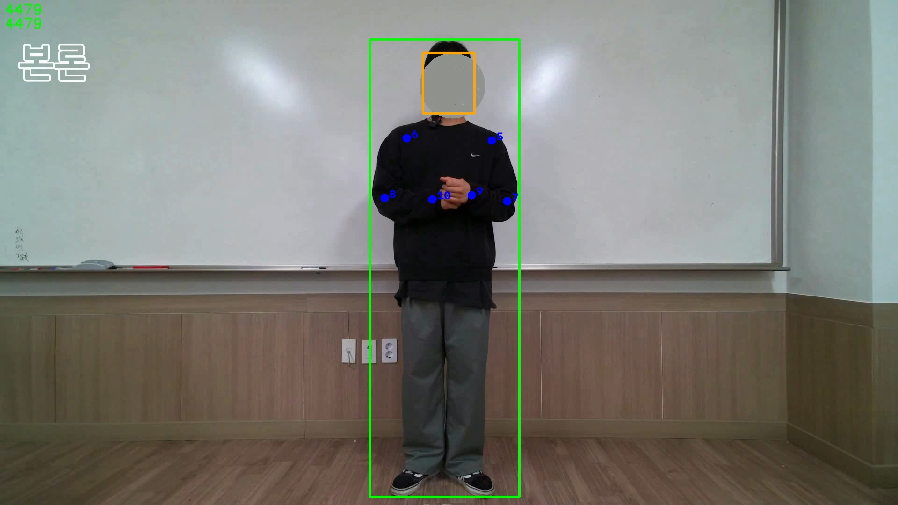
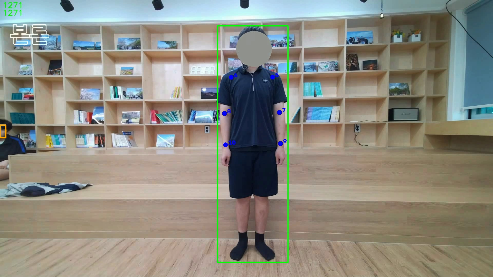
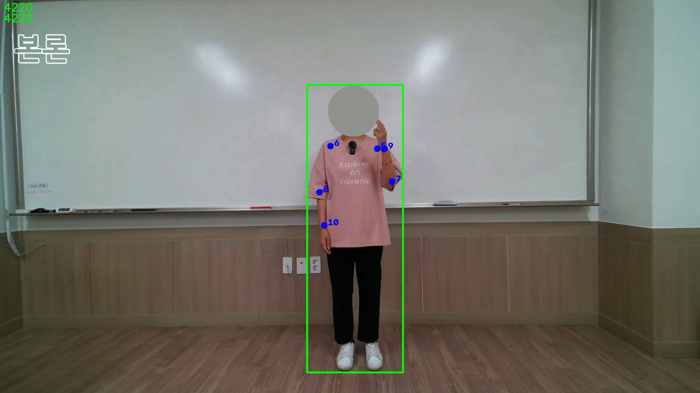

# YOLO 발표 영상 실시간 사용성 실험

> CPU 병렬화와 Apple GPU(MPS)를 같은 모델로 추가 측정한 결과는 [CPU·GPU 후속 실험 보고서](CPU_GPU_실시간_후속실험_보고서.md)를 참고한다. 아래 30FPS 부적합 판정은 CPU 1스레드 실행 구성에 한정된다.

실행일: 2026-11-04. 범위: YOLO11n-pose + YOLO5Face를 함께 사용하여 얼굴 출력, 몸 관절점, 팔 들기, 큰 손목 이동을 판정했다. **시선은 제외했다.**

## 결론

- **30FPS 입력의 모든 프레임을 처리하는 구성으로는 부적합하다.** 이 컴퓨터의 CPU 1스레드에서 최대 처리량은 16.74FPS였고, 30FPS 모의 재생에서는 44.1%의 프레임을 건너뛰었다.
- **초당 약 10회 행동 결과를 갱신하는 용도라면 속도만 보면 가능성이 있다.** 모의 재생의 실제 출력은 16.78회/초, 입력 예정 시각부터 판정 완료까지 지연 95백분위는 96.7ms였다. 실제 카메라·화면 표시·다른 앱 부하를 포함한 사용성은 아직 검증하지 않았다.
- **발표 행동의 정확도는 확정할 수 없다.** 기존 6개 영상에 행동별 시간 정답이 없고, 이번 단일 검토자의 표본 라벨은 양성이 적으며 수정 이력이 있다. 얼굴은 가려져 있어 실제 얼굴 검출의 정답 평가가 불가능하다.

## 입력과 고정 조건

| 조건 | 값 |
|---|---|
| 영상 | 기존 발표 영상 6개, 각 1920×1080·30FPS |
| 시험 구간 | 각 영상의 20%·50%·80% 위치를 중심으로 10초씩, 영상당 30초, 합계 180초·5,400프레임 |
| 환경 | Apple M5 MacBook Pro, 메모리 16GB, macOS 26.1, CPU, PyTorch 1스레드 |
| 모델 | 기존 `yolo11n-pose.pt`, `yolov5n-face.pt`; 새 학습·가중치 변경 없음 |
| 실행 설정 | 각 모델 신뢰도 0.5, 입력 640px, 관절 신뢰도 0.5, 예열 5프레임 |
| 처리 순서 | 영상 읽기 → YOLO5Face → YOLO pose → 관절 기반 행동 규칙 |
| 30FPS 재생 | 원본 프레임을 30FPS 간격으로 제공하고, 처리 중에는 가장 최신 프레임 하나만 보관. 오래된 미처리 프레임은 버림 |

20%·50%·80% 구간은 모델 예측을 보기 전에 고정했다. 이 구간은 영상 전체를 대표하는 무작위 표본이 아니고, 기존 실험에서 이미 영상의 일부를 살펴봤으므로 **미사용 독립 최종 평가 자료가 아니다.**

## 1. 저장 영상 최대 처리 속도

| 단계 | 중앙값 | 95백분위 | 99백분위 |
|---|---:|---:|---:|
| 영상 읽기 | 0.56ms | 0.63ms | 0.75ms |
| 얼굴 추론 | 32.00ms | 32.59ms | 33.62ms |
| 자세 추론 | 26.79ms | 27.55ms | 28.64ms |
| 행동 규칙 계산 | 0.05ms | 0.06ms | 0.07ms |
| 프레임 전체 | **59.45ms** | **60.66ms** | **62.97ms** |

5,400프레임 처리에 322.64초가 걸려 **16.74FPS**였다. 모델 로드와 예열은 제외했고, 지정 구간으로 이동하는 비용은 전체 경과 시간에 들어간다. 30FPS의 프레임 간격은 33.33ms이므로 얼굴+자세를 매 프레임 순차 실행하는 현재 구성은 입력 속도를 따라가지 못한다.

## 2. 30FPS 모의 재생

| 지표 | 결과 |
|---|---:|
| 입력·디코딩 프레임 | 5,400 |
| 실제 판정 출력 | 3,020 |
| 더 최신 프레임으로 덮여 처리되지 않은 프레임 | 2,380 (**44.07%**) |
| 출력 속도 | **16.78회/초** |
| 입력 예정 시각 → 판정 완료 지연 중앙값 | **80.99ms** |
| 같은 지연 95백분위 / 99백분위 | **96.70ms / 101.42ms** |
| 프레임 대기 시간 중앙값 / 95백분위 | 21.59ms / 37.09ms |

지연은 저장 영상을 30FPS로 공급한 **모의 입력 예정 시각부터 계산 완료까지** 측정했다. 실제 카메라 센서, 캡처 드라이버, 화면 렌더링, 네트워크 전송 시간은 포함하지 않는다. 최신 프레임만 보관했기 때문에 대기열이 계속 쌓이는 구성은 아니다.

## 3. 네 가지 판정 출력

| 항목 | 5,400프레임에서 확인된 결과 | 해석 |
|---|---:|---|
| 얼굴 검출 | 얼굴 박스 출력 312프레임(5.78%); 출력 신뢰도 중앙값 0.55, 범위 0.50–0.72; 이 중 102개 박스의 중심은 선택된 발표자 자세 박스 밖 | 얼굴이 회색 원으로 가려져 실제 얼굴 검출 성공률·위치 정확도는 계산 불가. 발표자 밖 102개는 A01 영상의 주변 인물 위치에서 나옴 |
| 몸의 주요 관절점 | 사람 자세 출력 5,400/5,400; 어깨·팔꿈치·손목 6점 모두 신뢰도 0.5 이상인 프레임 5,400/5,400 | 출력 존재와 신뢰도만 확인. 관절 정답 좌표가 없어 위치 PCK·오차는 계산 불가 |
| 팔 들기 | 손목 높이가 같은 쪽 어깨보다 어깨 너비의 10% 이상 높으면 `예` | 모델 관절의 기하학적 판정. 실제 사람의 팔 들기와 혼동 가능 |
| 큰 손목 이동 | 0.5초 전의 `(손목−어깨)` 벡터와 현재 벡터의 차이가 어깨 너비의 25% 이상이면 `예` | 손목 이동 대리 지표. 손가락 동작이나 발표 제스처의 의미를 구별하지 못함 |

얼굴 박스가 회색 가림 원에 생기는 사례와 주변 인물에 생기는 사례가 모두 있다. 이를 정상 얼굴 검출 TP로 취급하지 않았다. 자세 박스와 관절은 예시에서 발표자 몸을 대체로 따라가지만, 손목 오차로 팔 들기 판정이 틀린 사례도 확인했다.

| 영상 | 얼굴 박스 출력 프레임 / 900 | 사람 자세 출력 / 900 | 모델의 팔 들기 `예` | 모델의 큰 손목 이동 `예` |
|---|---:|---:|---:|---:|
| A00 | 79 | 900 | 0 | 8 |
| A01 | 102 | 900 | 0 | 0 |
| A02 | 23 | 900 | 0 | 45 |
| A03 | 25 | 900 | 43 | 166 |
| A04 | 83 | 900 | 26 | 89 |
| A05 | 0 | 900 | 127 | 207 |

이 표는 **모델 출력 횟수**다. 정답 행동 횟수나 검출 성공 횟수가 아니다. A01에서 176프레임은 사람 자세 출력이 2개였고, 이 실험은 면적이 큰 박스를 발표자로 선택했다.

초록: 사람 자세 박스, 파랑: 어깨·팔꿈치·손목, 주황: 얼굴 모델 박스. 주황 박스는 실제 얼굴이 아니라 가려진 영역 위의 출력이다.

A01에서 얼굴 모델이 왼쪽 주변 인물을 찾았고, 자세 모델의 큰 박스는 중앙 발표자를 선택했다. 얼굴 출력 수만으로 발표자 얼굴 성공률을 계산하면 잘못된 결과가 된다.

손이 얼굴 근처에 있지만 파란 손목점 `9`가 어깨 높이 부근에 찍혀 팔 들기 규칙이 `아니요`를 반환한 예시다.

## 4. 행동 품질: 탐색용 표본 점수

행동별 시간 정답은 제공되지 않았다. 그래서 위 18개 구간에서 **1초마다 하나의 프레임 또는 0.5초 간격 프레임 쌍**, 총 180개를 원본 영상 시트로 단일 시각 검토했다. 모델의 프레임별 예측을 보지 않고 만든 첫 라벨은 축소 영상에서 팔 위치를 잘못 읽은 사례가 있었고, 모델 불일치를 확인한 후 상체 확대 시트로 다시 보았다. 따라서 아래 **수정 라벨 점수는 사후 재검토가 섞인 탐색 결과**이며 독립 검증 점수가 아니다. 라벨 파일 첫 버전과 수정본을 모두 보존했다.

| 행동 | 평가 표본(양성) | 30FPS 재생 TP / FP / FN | Precision | Recall | F1 |
|---|---:|---:|---:|---:|---:|
| 팔 들기 | 176(6) | 5 / 0 / 1 | 1.000 | 0.833 | **0.909, 잠정** |
| 큰 손목 이동 | 174(23) | 17 / 2 / 6 | 0.895 | 0.739 | **0.810, 잠정** |

불확실한 표본은 팔 4개, 손목 이동 6개를 제외했다. 프레임을 처리하지 못했거나 관절·행동 출력이 없으면 `아니요`로 채점했다. 저장 영상 최대 속도 모드에서 같은 표본의 F1은 팔 **0.909**, 손목 이동 **0.780**이었다. 손목 이동의 0.030 차이를 성능 향상으로 해석할 수 없다. 표본 시점과 30FPS 재생에서 선택된 프레임이 달라진 결과이며, 양성도 23개뿐이다.

특히 팔 들기는 첫 라벨의 F1이 **0.727**이었고, 확대 검토에서 2개 라벨을 바로잡자 **0.909**가 됐다. 이 큰 변동이 이번 표본 점수를 제품의 정확도 근거로 쓰기 어려운 이유다. 양성이 A03·A05에 집중되어 6명 전체의 성능을 대표하지 않는다. `큰 손목 이동`도 의미 있는 발표 제스처, 얼굴 만지기, 옷 만지기를 분리하지 않는다.

## 5. 행동 시작 후 지연

사람이 붙인 행동 **시작 시각 정답은 없으므로 실제 행동 시작→감지 지연은 측정 불가**다. 대신 프레임을 건너뛰는 영향만 살펴보기 위해, 저장 영상에서 모델이 `예`로 바뀐 시각을 기준으로 30FPS 재생의 첫 `예` 출력까지 계산했다. 0.1초 이상 지속된 **모델 자체의** 팔 들기 9건 중 누락 0건, 큰 손목 이동 33건 중 누락 1건이었다. 일치한 건의 모델 기준 지연 중앙값은 둘 다 약 96ms였다. 이는 실제 행동 정답과의 지연이 아니므로 제품 감지 지연으로 인용하면 안 된다.

## 판단과 다음 확인

현재 CPU의 얼굴+자세 동시 구성은 **30FPS 모든 프레임 분석에는 실패**했다. 반면 최신 프레임 방식에서 약 17Hz·95백분위 지연 97ms였으므로, **10Hz 수준의 행동 피드백은 속도 측면에서 시험을 이어갈 가치가 있다.** 정확도와 실제 카메라 사용 가능성은 확인되지 않았다.

확정 판단에는 (1) 발표자 얼굴이 가리지 않은 별도 영상, (2) 여러 화자·다양한 큰 동작의 시간 구간을 두 명 이상이 독립 주석한 자료, (3) 설정 선택에 쓰지 않은 영상의 행동별 F1과 실제 행동 시작 지연, (4) 카메라·화면 출력까지 포함한 장시간 실행이 필요하다. 현재 6개 영상의 여러 구간을 이미 확인했으므로 같은 영상에서 다시 임계값을 고른 뒤 나온 상승은 독립 개선으로 취급하지 않는다.

## 재현 파일

- [실험 코드](realtime_yolo_benchmark.py), [검토 시트 생성](make_realtime_review_sheets.py), [잠정 점수 계산](score_realtime_review.py)
- [속도 요약 JSON](results/realtime_yolo/summary.json), [잠정 행동 점수 JSON](results/realtime_yolo/behavior_review_summary.json)
- [저장 영상 프레임별 출력](results/realtime_yolo/offline_frames.csv), [30FPS 재생 프레임별 출력](results/realtime_yolo/paced_frames.csv)
- [첫 라벨](results/realtime_yolo/review_labels_v1.json), [확대 검토 수정 라벨](results/realtime_yolo/review_labels.json), [원본 검토 시트](results/realtime_yolo/review_sheets_upper)
