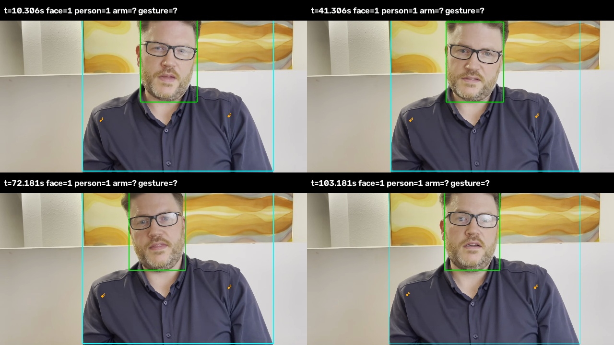
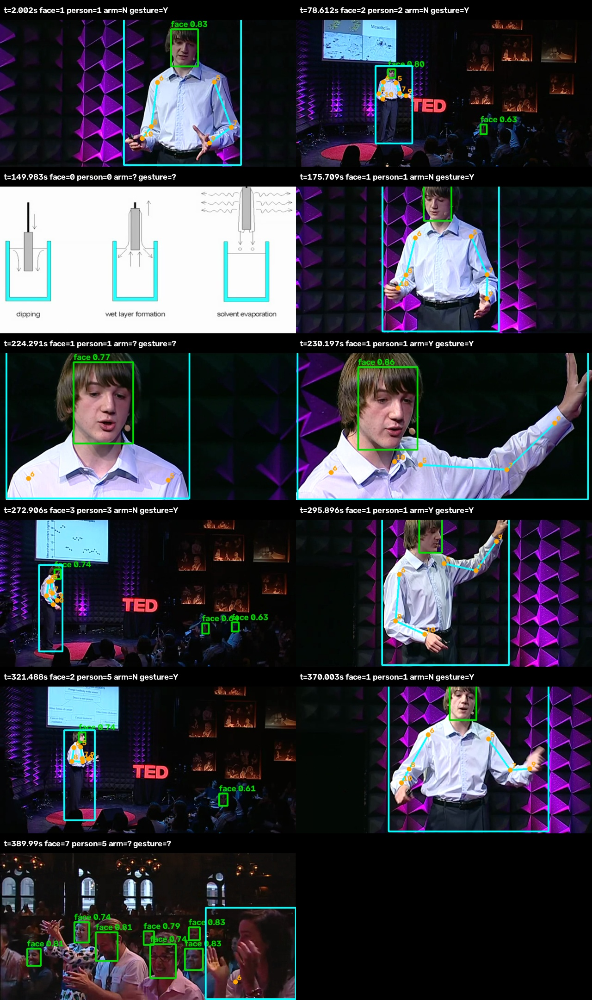

# 공개 발표 영상의 얼굴·관절·행동 출력 점검

## 실험 범위

- 영상: [Erik Hanberg Wikimania Lightning Talk](https://commons.wikimedia.org/wiki/File:Erik_Hanberg_Wikimania_Lightning_Talk.webm), Erikemery, [CC BY-SA 4.0](https://creativecommons.org/licenses/by-sa/4.0/), 128.93초·3,095프레임·약 24fps; [Jack Andraka 발표](https://commons.wikimedia.org/wiki/File:Jack_Andraka_-_Detecting_pancreatic_cancer_at_15.webm), TEDTalentSearch, [CC BY 2.5](https://creativecommons.org/licenses/by/2.5/), 400.03초·11,990프레임·약 30fps. 원본과 출처는 `data/open_presentations/manifest.json`에 기록했다.
- 기존에 선택한 B 조합인 **YOLO11n-pose + YOLO5Face(yolov5n-face)** 를 모든 프레임에 적용했다. 입력 크기 640, 얼굴·사람 검출 임계값 각각 0.5, 관절 신뢰도 임계값 0.5, Apple MPS를 사용했다. 행동 규칙은 기존 `realtime_yolo_benchmark.py`의 규칙을 사용했다.
- 이 영상에는 얼굴·관절 박스와 행동·시선의 사람 정답 주석이 없다. 아래 비율은 **출력 가능 비율**이며 precision, recall, F1 또는 정답 인식률이 아니다. 영상은 화면 전환, 슬라이드, 청중 장면을 포함한다.

## 전체 프레임의 출력

| 항목 | Erik: 3,095프레임 | Jack: 11,990프레임 | 해석 |
|---|---:|---:|---|
| 얼굴이 하나 이상 출력됨 | 3,095 (100.0%) | 8,030 (67.0%) | Jack에서는 청중 얼굴도 포함된다. 발표자 얼굴 검출 재현율이 아니다. |
| 사람이 하나 이상 출력됨 | 3,095 (100.0%) | 8,460 (70.6%) | 청중도 포함된다. |
| 선택된 사람의 양쪽 어깨·팔꿈치·손목 6점 모두 유효 | 0 (0%) | 6,234 (52.0%) | Erik은 상반신만 촬영돼 팔꿈치·손목이 화면 밖이다. |
| 팔 들기 판정 가능 | 0 (0%) | 6,444 (53.7%) | 양쪽 어깨와 적어도 한쪽 손목이 유효하고 어깨 너비를 계산할 수 있는 프레임. |
| 팔 들기 결과 `예/아니요/판정 불가` | 0 / 0 / 3,095 | 139 / 6,305 / 5,546 | `예`는 판정 가능 프레임 중 2.2%. 사람이 확인한 정답률은 아니다. |
| 큰 손목 이동 판정 가능 | 0 (0%) | 6,267 (52.3%) | 현재 프레임과 약 0.5초 전 같은 쪽 어깨·손목이 유효한 프레임. |
| 큰 손목 이동 결과 `예/아니요/판정 불가` | 0 / 0 / 3,095 | 4,333 / 1,934 / 5,723 | `예`는 판정 가능 프레임 중 69.1%. 의미 있는 제스처의 비율이 아니다. |
| 청중과 시선 접촉 Y/N | 산출 불가 | 산출 불가 | 이 모델 출력에 시선 벡터·청중 위치·사람 정답이 없다. |

처음 코드는 손목이 무효여도 `팔 들기=False`로 기록하는 오류가 있었다. 이를 수정해 **판정 불가**로 기록했다. 따라서 Erik의 팔 들기 결과를 `0/3,095회`라고 해석하면 틀린다.

## 항목별로 실제 보이는 모습

### 얼굴 위치와 신뢰도

얼굴 모델은 `[x1, y1, x2, y2, 검출 신뢰도]`를 저장한다. 예를 들어 Erik 10.306초에는 `[878, 109, 1233, 638, 0.86]`, Jack 230.197초에는 `[179, 96, 350, 332, 0.86]`이 출력됐다. 아래 표본 그림에서 녹색 박스가 눈으로 보이는 얼굴 부위에 대체로 놓여 있다. 검출 신뢰도 0.86은 **86% 정확도**가 아니다.

Jack 389.990초에는 얼굴 7개가 출력되지만 화면은 **청중 장면**이다. 따라서 `얼굴 하나 이상`을 발표자 얼굴 검출로 사용하면 잘못된 양성이 생긴다. 149.983초에는 얼굴·사람 출력이 모두 0인데 슬라이드 장면이어서 발표자 검출 실패로 셀 수 없다.

앞서 고정 간격으로 뽑은 40장에 대해 조수의 육안으로 발표자 얼굴을 살펴볼 수 있다고 표시한 프레임은 29장이었고, 그 29장에는 YOLO 얼굴 출력이 하나 이상 있었다. 이는 동일 영상의 작은 사후 점검이고 **출력 얼굴이 발표자와 맞는지 박스 정답으로 대조한 결과가 아니므로** 얼굴 recall·F1로 부르지 않는다. 기록은 `data/open_presentations/assistant_visual_pilot_labels.csv`에 있다.

### 몸의 주요 관절점

청록색 박스는 선택된 사람, 주황색 점과 선은 유효한 어깨(5·6), 팔꿈치(7·8), 손목(9·10)이다. Jack 근경 175.709초와 295.896초에는 관절이 팔에 대체로 맞는다. 원경 272.906초에는 관절이 아주 작은 영역에 몰려 있어 정밀한 위치 판단이 어렵다. 여러 사람이 있을 때 현재 코드는 **가장 큰 사람 박스**를 선택하므로 발표자 추적을 보장하지 않는다. 정답 관절 좌표가 없으므로 PCK·OKS 같은 위치 정확도를 계산하지 않았다.

Erik 10.306초에는 양쪽 어깨만 유효하고 팔꿈치·손목 네 점이 모두 무효다. 네 장면뿐 아니라 3,095프레임 전체에서 유효한 팔꿈치·손목 출력이 0이었다. 이 영상은 팔·손 제스처 평가용으로 부적합하다.

### 팔 들기 Y/N

규칙은 유효한 손목의 y좌표가 같은 쪽 어깨보다 **어깨 너비의 0.1배 이상 위**에 있으면 `예`다. Jack 230.197초와 295.896초에는 실제로 팔을 어깨 위로 올린 장면과 `예`가 일치하는 모습을 확인했다. 370.003초에는 양팔을 옆으로 벌렸지만 손목이 어깨보다 위에 있지 않아 `아니요`다. 이는 현재 규칙에 따른 출력이며 팔 자세의 모든 의미를 포착하지 않는다.

### 큰 손동작 Y/N

현재 프레임과 약 0.5초 전의 `손목−어깨` 벡터 변화가 **어깨 너비의 0.25배 이상**이면 `예`다. Jack 370.003초의 큰 팔 움직임은 `예`, 얼굴만 나온 224.291초는 손목이 없어서 `판정 불가`다. 단, 4,333개의 `예`에는 발표 동작, 카메라 전환, 잘못된 사람 추적 또는 관절 흔들림이 섞일 수 있다. 주석 없이 제스처 인식 F1이나 유용성을 판단할 수 없다.

### 청중을 보는지 Y/N

이 두 YOLO 모델의 현재 저장 출력은 얼굴 박스와 몸 관절이며, 동공 방향이나 청중의 위치를 담지 않는다. Jack의 카메라는 근경·원경·청중 장면을 전환하고, Erik은 카메라 앞에서 촬영되어 화면 속 청중 자체가 없다. 따라서 고개나 얼굴 방향만 보고 `청중을 봄=예/아니요`라고 쓰지 않았다. 평가하려면 청중 위치가 보이는 구간을 따로 정하고 사람이 `예/아니요/판정 불가`를 주석해야 한다. 고개 방향 추정값도 그 정답을 대신하지 못한다.

## 실제 출력 그림

녹색=얼굴, 청록색=선택된 사람, 주황색=유효 관절. 상단 `arm`, `gesture`는 Y=예, N=아니요, ?=판정 불가다. 영상 원본의 프레임을 축소해 표시했다.

## 판단

**이 두 영상에서는 YOLO 조합으로 얼굴·몸 박스와, 관절이 보이는 구간의 팔 들기·손목 이동 출력까지 만들 수 있다.** Jack의 근경·원경 예시에서 발표자의 얼굴과 팔 위치가 시각적으로 그럴듯하게 표시된다. 반면 Erik 영상은 손이 거의 화면 밖이라 행동 평가에 쓸 수 없고, Jack의 전체 프레임 얼굴·사람 출력률은 청중·슬라이드 장면 때문에 정확도 지표가 아니다. 큰 손목 이동 출력의 69.1% 양성률은 실제 제스처 정확도로 검증되지 않았다. 청중과 시선 접촉은 현재 파이프라인으로 평가하지 못한다.

얼굴·관절 위치 정확도와 행동별 precision·recall·F1을 주장하려면, 발표자 박스·보이는 관절·시간 구간별 행동을 사람이 주석하고 모델 출력과 매칭해야 한다. 시선은 화면별 청중 방향과 `판정 불가` 기준을 별도로 만들어야 한다. 같은 영상의 일부로 임계값을 조정했다면 그 부분을 최종 독립 평가로 다시 쓰지 않는다.

## 재현 파일

- 프레임별 좌표·신뢰도·행동 출력: `results/open_presentations_yolo/*_frames.csv`
- 집계: `results/open_presentations_yolo/summary.json`
- 실행: `evaluate_open_presentations.py`
- 예시 그림 생성: `make_open_presentation_examples.py`

